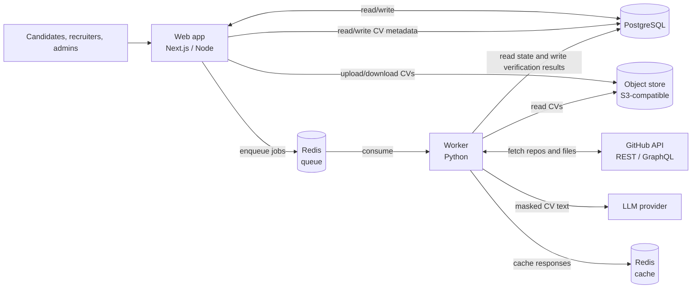
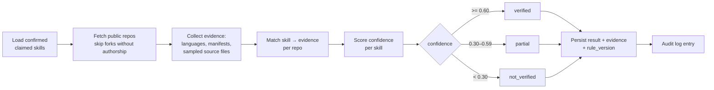

# System Design: GitHub-Verified Skills Recruitment Platform

Nov 20, 2026 · derived from the [PRD](../product/PRD.md) and [TRD](TRD.md)

This document describes how the MVP is put together: the components, how data moves between them, where state lives, and the trade-offs behind the main choices. The PRD says what to build; the TRD fixes the stack and contracts; this file explains the shape of the system and why it holds.

## 1. Design goals and constraints

The system exists to turn a CV and a GitHub link into a verified-skills profile whose every claim can be inspected. Four constraints drive most of the architecture:

| Constraint | Architectural consequence |
| --- | --- |
| A GitHub scan takes seconds to minutes and GitHub rate-limits us | Verification is a background job. The web request never blocks on GitHub; state is persisted per step so a scan resumes after a pause. |
| Every verified skill must be defensible | Evidence and the rule version are stored alongside each result. Verification rows are append-and-supersede, never silently overwritten. |
| The apply gate must be deterministic and auditable | Matching is plain server-side code over stored `verified` rows. No LLM, no search engine scoring, no client-side gate. |
| Pilot scale is hundreds of candidates and tens of recruiters | One Postgres, one Redis, a web app and a worker. No microservices, no separate search cluster, no event bus. |

Explicit non-goals for this design: private repositories, non-GitHub evidence sources, native apps, real-time collaboration, and any capacity planning beyond the pilot.

## 2. Component overview

Six deployable pieces plus two external dependencies.

| Component | Role | Owns |
| --- | --- | --- |
| Web app (Next.js / Node) | Serves UI and REST API, enforces auth and the apply gate | All request-time behaviour, all writes except verification results |
| Worker (Python) | CV parsing and GitHub scanning | Rows in `cvs.parsed_json`, `github_repos`, `skill_verifications`, `verification_evidence` |
| Queue (Redis) | Durable-ish job list with retry and backoff | Job lifecycle: queued, running, paused, failed |
| Cache (Redis) | GitHub responses keyed by ETag, plus short-lived search caches | Nothing authoritative — safe to flush |
| PostgreSQL | System of record | Users, profiles, CVs, skills, verifications, jobs, applications, audit log |
| Object store (S3-compatible) | Private CV files | Bytes only; metadata lives in `cvs` |
| GitHub API | Source of evidence | External; read-only, public data |
| LLM provider | CV text → structured skill JSON | External; receives masked text only |

**Boundary rule:** only the worker writes verification tables. Only the web app writes everything else. This keeps the integrity-critical path single-writer and makes the audit trail trustworthy.

## 3. Core flows

### 3.1 Onboarding and verification (candidate)

1. Sign up → `users` row with role, email verification sent.
2. Upload CV → file to object store, `cvs` row, `post-cv-parse` job enqueued. Upload responds immediately; parsing is invisible to the request.
3. Worker extracts text, masks PII, calls the LLM, validates the JSON against a schema and the skill taxonomy, writes candidate skill suggestions. Nothing enters verification yet.
4. Candidate confirms, edits or removes extracted skills → `claimed_skills.confirmed_by_candidate`. **This gate exists so a bad extraction can never become a false verification claim.**
5. Candidate links GitHub via OAuth → read-only token encrypted at rest; consent timestamp recorded.
6. `POST /me/verification` → `verify-candidate` job enqueued keyed by candidate id.
7. Worker walks the pipeline (section 4), writing rows as it goes. `GET /me/verification` is polled for status.
8. On completion, verified skills appear on the public profile with evidence; partial and not-verified skills remain visible to the candidate with reasons.

The whole sequence targets under three minutes median. The slowest step is GitHub pagination on large accounts, which is why the scan is ordered largest-and-most-recent-first: a partial result that already covers the likely evidence is worth more than a complete scan that finishes late.

### 3.2 Search and apply (recruiter and candidate)

- Search reads `skill_verifications` filtered to `status = 'verified'`, joined to `skills` for normalisation, and to `candidate_profiles` for filters. Postgres handles this with a composite index on `(skill_id, status)`; pilot cardinality is thousands of rows, so no external index is needed.
- A job stores `match_mode` (`all` or `minimum`) and `min_match`. Eligibility is computed by a single deterministic function over the job's required skills and the candidate's verified skills. `minimum` requires `1 <= min_match <=` the number of required skills and is rejected otherwise at job creation — a floor of zero would open the gate to every candidate.
- Apply writes an `applications` row that **snapshots** matched and missing skills. Later re-scans change the profile, never the historical application.
- The gate is enforced twice — in the UI to explain, and in the API to decide — but only the API result counts. A failed gate returns `403` with `missing_skills` so the candidate learns exactly what to close.

### 3.3 Re-verification (P1)

New commits or an explicit request enqueue the same job with the same candidate key. Existing rows are superseded: the current row moves to history, the new row carries a new `rule_version`. A failed or partial scan leaves the previous verified row in place, so reliability never costs a candidate their badge.

## 4. Verification pipeline

**Job granularity.** One job per candidate, not per repository. Per-skill progress is stored, so a rate-limit pause resumes at the next repository rather than restarting the profile. Rate-limit handling checks remaining quota before each batch, honours `X-RateLimit-Reset`, and uses conditional requests so repeated scans cost almost nothing.

**Scoring.** The weights are additive and deliberately simple, so a reviewer can reconstruct any result by hand; see [VERIFICATION_RULES.md](../engineering/VERIFICATION_RULES.md) for the numbers. Repos flagged as forks, clones or trivial contribute zero. A manifest entry alone tops out below `verified` — weak by construction, as the PRD requires.

**Why the worker is Python.** CV layout handling and source-file/import parsing have mature Python libraries. The cost is two languages and two deployment units; the benefit is not reimplementing parsers in Node.

## 5. Data and state

Thirteen tables, with the verification cluster carrying the interesting invariants:

- `skill_verifications` — one *current* row per `(candidate, skill)`. The unique index on that pair is what makes "what is this candidate's verified skill set" a single cheap read. Prior rows are retained as history for audit.
- `verification_evidence` — many per verification; the join that lets a recruiter click a skill and see the repos, files and line counts behind it.
- `audit_log` — append-only, holds `rule_version` and a JSONB payload. Deleting an account removes personal data but keeps the pseudonymous decision record.
- `applications` — denormalises matched/missing skills on purpose. Normalising them would make historical applications drift as profiles change.

Indexing that matters at pilot scale: `skill_verifications(skill_id, status)` for search, `applications(job_id, created_at)` for applicant lists, `github_repos(candidate_id)` for scan resume, and a GIN index on `audit_log.payload` only if admin queries demand it.

## 6. API surface

REST over HTTPS, versioned at `/api/v1`, single JSON error shape (`code`, `message`, plus fields like `missing_skills`). Conventions that shape the client:

- Async verification: the POST returns a job id, the GET is the source of truth. The UI shows scan progress from the GET rather than guessing.
- Server-side role enforcement on every route; ownership checked for jobs and CVs.
- Pagination on every list; paginated search is capped per page to protect the database.
- Rate limits applied on sign-up, login, search and verification triggers — separately per user and per IP.

## 7. Security and privacy posture

The design treats three assets as sensitive: CV contents, GitHub tokens, and the truthfulness of verification results.

- **Token handling** — read-only public scopes, encrypted at rest, revocable; never sent to the client.
- **CV handling** — private bucket, server-side encryption, short-lived signed URLs, virus scan before use.
- **LLM boundary** — PII is masked before the call, the provider is contractually barred from training on submissions, and the response is schema- and taxonomy-validated. The LLM never sees the apply decision and never writes verification results.
- **Fairness by construction** — name, gender, photo, age and location are not columns the scoring function may read. Keeping them out of `skill_verifications` input is easier to audit than filtering them later.
- **Data rights** — consent recorded with a timestamp; export and delete endpoints; deletion cascades to CV bytes, repo data and verification rows.

## 8. Reliability, performance and observability

| Concern | Approach |
| --- | --- |
| Scan failure | Job retries with exponential backoff; partial results persisted; last good verification rows untouched. |
| Rate limits | Quota check per batch, ETag caching, resume after reset. Largest repos first. |
| Verification latency | Target under 3 min median; measure p50/p90 per `rule_version` rather than only overall. |
| Web latency | Next.js server rendering; search served from indexed Postgres queries; no request-time GitHub calls. |
| Debuggability | One request id and one verification job id on every log line; worker and web logs share the correlation id. |
| Alerting | Failed jobs, queue depth above threshold, GitHub error-rate spikes, apply-gate rejection rate drift. |
| Recovery | Daily Postgres backups with a rehearsed restore; bucket versioning for CVs. |

Metrics that decide whether the system works are the PRD's: verification time, precision on the labelled set, dispute rate, and gate-driven candidate loss. Those are product metrics computed from stored rows — which is why the audit log and evidence tables are designed before the UI is.

## 9. Key trade-offs

| Decision | Chosen | Rejected | Why |
| --- | --- | --- | --- |
| Scan mechanism | GitHub API only, no cloning | Clone repos for deeper analysis | Cloning costs disk, time and legal surface; API files plus manifests cover the MVP evidence rules. Revisit if recall is poor. |
| Search | Postgres indexes on verification rows | Elasticsearch / OpenSearch | Pilot volume fits Postgres comfortably; a second datastore adds ops load with no measured benefit. |
| Service split | Web app + one worker | Microservices | Two units map to the real async boundary; more splits would be ceremony at this scale. |
| Verification storage | Current row + history | Recompute on read | Storing the result with its evidence and rule version is what makes audit and dispute possible. |
| Apply gate | Deterministic server-side policy flag | LLM-ranked eligibility | Gating candidates must be explainable and reproducible; an LLM here would be unauditable. |
| Language split | Node web + Python worker | Single language | Parser maturity outweighs the duplication cost. |
| Evidence granularity | Per skill, with per-repo evidence rows | Per repo only | The product's promise is per-skill explainability. |

## 10. What would change at 10× scale

Not needed for the pilot, but the seams exist:

- Search moves to a dedicated index once verification rows pass roughly a million or filters need fuzzy matching.
- The worker shards by candidate id and gets a per-candidate serialisation lock so re-scans do not race.
- GitHub access moves behind a shared cache service with a global quota budget instead of per-worker checks.
- Evidence moves to columnar storage if per-file rows grow into the tens of millions.

Each is reachable without changing the API contract or the data model, which is the point of keeping the write paths single-owner.

## 11. Open questions carried from the TRD

- [ ] Hosting provider and region, given data residency and latency for users in Bangladesh.
- [ ] LLM provider, model and monthly cost cap for CV extraction.
- [ ] API-only versus clone-based repository analysis in the MVP.
- [ ] Who owns the confidence threshold and its calibration on the labelled set.
- [ ] GitHub sign-in: required for candidates, or optional alongside email and password.
- [ ] Target maximum scan time and maximum repositories scanned per profile.
- [ ] Which data protection regime applies at launch, and whether it forces local storage.
