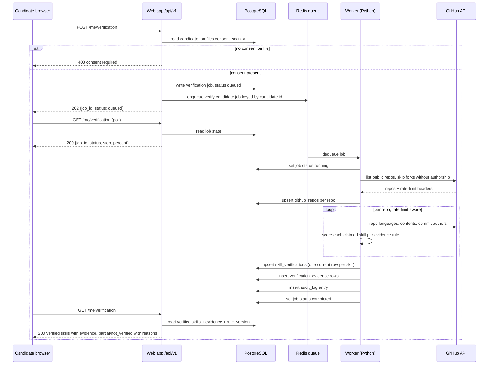

# Verification sequence

The major process described in the docs: a candidate triggers a GitHub verification and the system returns verified skills with evidence. Based on `TRD.md` §4 and `SYSTEM_DESIGN.md` §3.1. If the pipeline changes, edit the source documents, not this diagram.

## Actors

| Actor | Owns |
| --- | --- |
| Candidate browser | the request and the poll |
| Web app /api/v1 | auth, consent check, enqueue, status read, the `403` path |
| PostgreSQL | system of record for jobs, verifications, evidence, audit |
| Redis queue | durable-ish job list; resumes a paused scan rather than restarting it |
| Worker (Python) | walks the pipeline, writes `github_repos`, `skill_verifications`, `verification_evidence`, `audit_log` |
| GitHub API | source of evidence; read-only public data, rate-limited |

## Why this process, not another

- One job per candidate, not per repository, so a rate-limit pause resumes at the next repository instead of restarting the profile.
- The GET is the source of truth for status; the UI polls it rather than guessing from the enqueue response.
- Only the worker writes the verification tables; the web app only writes the job row and reads status, which keeps the integrity-critical path single-writer.
- `verification_evidence.repo_id` is `SET NULL` on delete, so evidence survives if a repository row is later removed.

Related: `ER_DIAGRAM.md` for the tables this flow writes, `SYSTEM_DESIGN.md` §3.1 and §4 for the same flow in prose, `RUNBOOK.md` for what to do when a stage fails.
